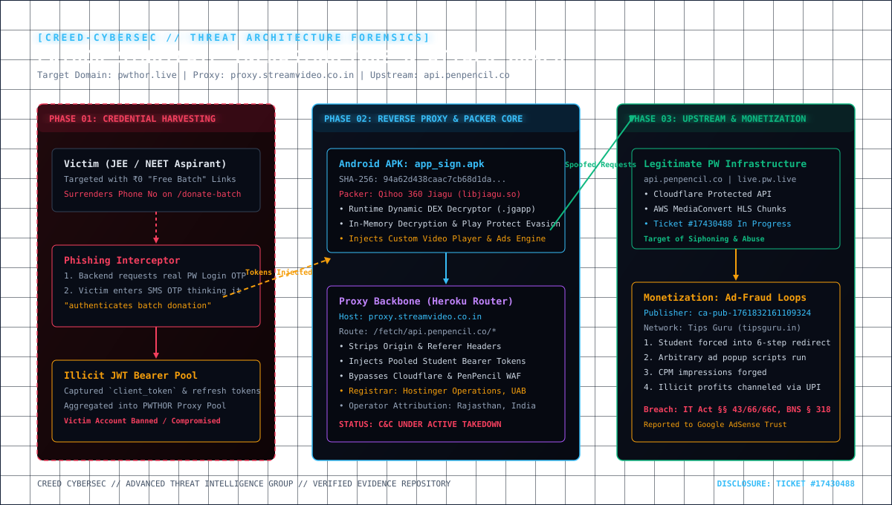
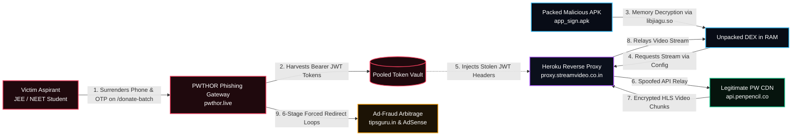
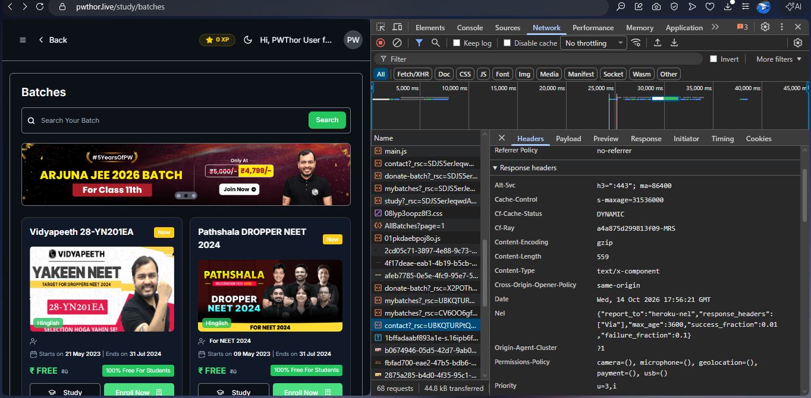
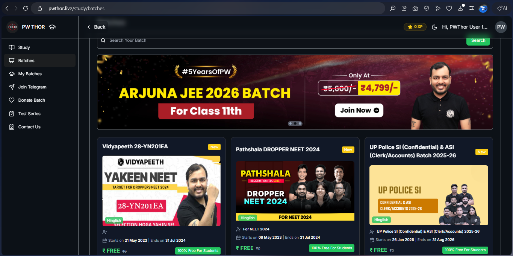
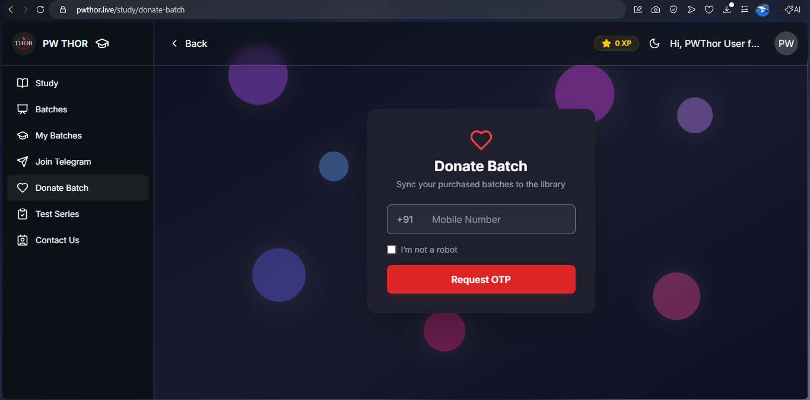
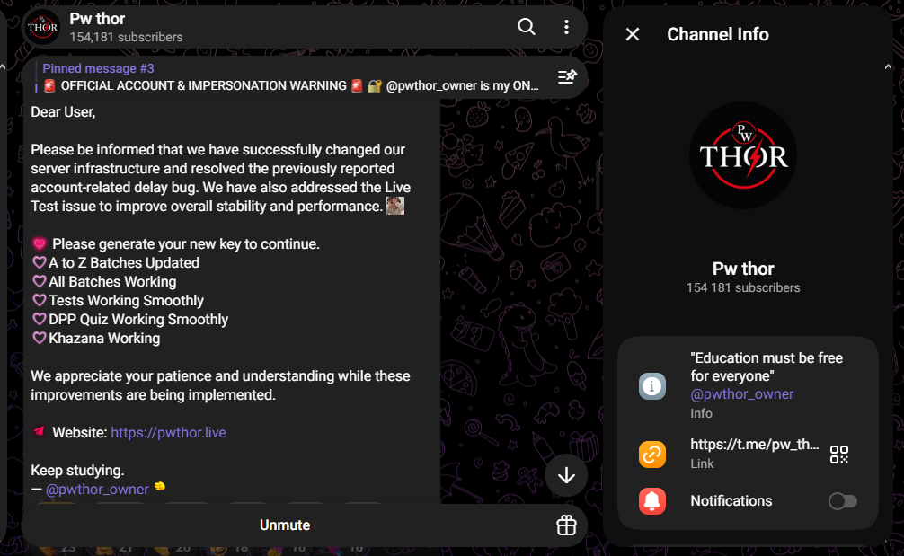
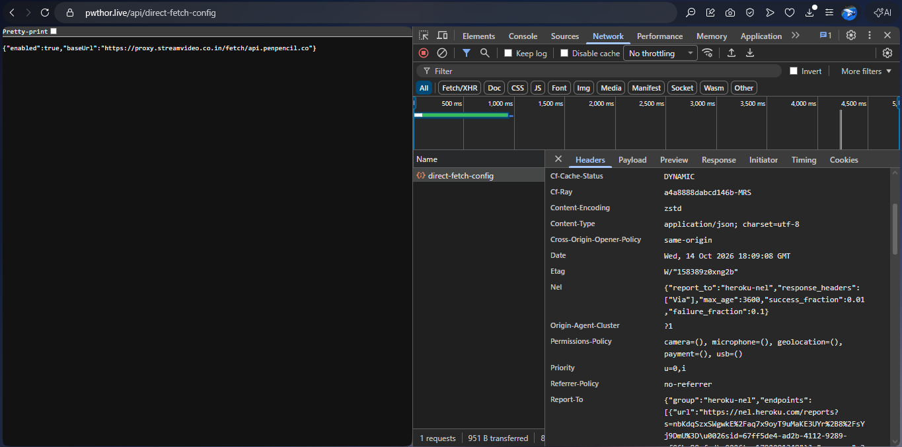

# Dissecting PWTHOR: How an Educational "Free Batch" Network Harvests Student OTPs & Proxies PenPencil Infrastructure

<div align="center">

[](https://github.com/creedcybersec-dev/PWTHOR-Threat-Advisory)
[-critical?style=for-the-badge&logo=target)](https://github.com/creedcybersec-dev/PWTHOR-Threat-Advisory)
[](https://github.com/creedcybersec-dev/PWTHOR-Threat-Advisory/blob/main/docs/DISCLOSURE_TIMELINE.md)
[](https://creativecommons.org/licenses/by/4.0/)

<br/>

**A Technical Threat Intelligence Advisory & Reverse-Engineering Whitepaper**  
**Published by CreeD CyberSec Threat Intelligence Desk**  
*Lead Researchers: CreeD CyberSec (`creedcybersec@gmail.com` | `creedcybersec@proton.me`)*  
*Initial Disclosure Date: October 15, 2026 | Last Updated: October 16, 2026*

</div>

---

## 🗺️ Visual Threat Architecture & Attack Graph

Below is the verified end-to-end architecture topology reconstructed through memory forensics, network packet interception, and reverse engineering:

<div align="center">
  
</div>



---

## 📑 Executive Summary

Over the past six months, Indian competitive exam aspirants (JEE, NEET, NDA, and UPSC) have been targeted by mass promotional campaigns across Telegram, YouTube shorts, and pirated forums advertising **"PWTHOR"**—a platform claiming to offer **100% free access to ₹5,000–₹10,000 paid batches** from India's largest educational technology provider, Physics Wallah (PenPencil infrastructure).

An independent forensic investigation conducted by **CreeD CyberSec** demonstrates that PWTHOR is not a benign distribution mirror, but a **sophisticated, multi-tier cybercrime operation** engaging in:

1. **Malware Obfuscation & Dynamic In-Memory Evasion:** Distribution of Android binaries (`app_sign.apk`) fortified with **Qihoo 360 Jiagu (360加固)**—a commercial Chinese packer frequently leveraged in financial trojans—to defeat Google Play Protect and static heuristic scanners.
2. **Infrastructure Spoofing & Cloud Proxy Hijacking:** Operation of an unauthenticated reverse-proxy gateway (`proxy.streamvideo.co.in`) hosted on a **Heroku Cowboy router** that intercepts proprietary API routes (`/fetch/api.penpencil.co`) and strips origin headers.
3. **Phishing & Account Hijacking via Credential Surrender:** Deployment of an active social-engineering vector (`/study/donate-batch`) that convinces students to enter their phone numbers and surrender official Physics Wallah SMS login OTPs, enabling the syndicate to harvest valid JWT bearer session tokens.
4. **Ad-Fraud Arbitrage & Monetization:** Forcing students through 6-stage malicious redirect chains via `tipsguru.in` to inflate impressions under Google AdSense Publisher ID `ca-pub-1761832161109324`.

Formal disclosures have been served to **Physics Wallah Security & Compliance (Ticket #17430488)**, Hostinger Trust & Safety, and cloud hosting providers.

---

## 🔍 Technical Deep Dive

### 1. The Mobile Binary: Qihoo 360 Jiagu Native Decryption

The distributed Android binary (`app_sign.apk`) displays the following forensic properties:

| Property | Value |
| :--- | :--- |
| **Artifact** | `app_sign.apk` |
| **File Size** | 14,740,713 bytes (14.05 MB) |
| **SHA-256** | `94a62d438caac7cb68d1da77af421c3c4d7fe7cf74d03ca7ad9bc776f98fe308` |
| **Signing Key** | Generic AOSP Debug Certificate (`CN=Android, OU=Android, O=Android, C=US`) |
| **Primary Stub Class** | `com.stub.StubApp` |
| **Packer Classification** | **Qihoo 360 Jiagu Enterprise Packer** |

#### Static vs. Runtime Disassembly

When submitted to static decompiler suites (`jadx`, `apktool`, `dexdump`), the primary `classes.dex` file is virtually hollow: it contains fewer than 300 generic strings and only initialization stubs. The entire functional Dalvik executable bytecode is encrypted inside `assets/.jgapp`.

<div align="center">
  
  <p><em>Figure 1: APK decompression exposing <code>assets/libjiagu.so</code>, <code>assets/libjiagu_64.so</code>, and the encrypted DEX payload <code>assets/.jgapp</code>.</em></p>
</div>

#### Memory Unpacking Sequence

The execution workflow executed by the native library during cold start is documented below:

```
[ Application Process Created ]
               │
               ▼
[ com.stub.StubApp.attachBaseContext() ]
               │
               ▼
[ System.loadLibrary("jiagu") ] ─────────► [ Loads assets/libjiagu.so into memory ]
                                                      │
                                                      ▼
                                           [ In-Memory Anti-Debugging Check ]
                                           - Checks /proc/self/status (TracerPid != 0)
                                           - Checks for Fridad / Xposed hooks
                                                      │
                                                      ▼
                                           [ Decryption of assets/.jgapp in RAM ]
                                           - Allocates anonymous RWX memory block
                                           - RC4/AES derivative decryption
                                                      │
                                                      ▼
                                           [ Native InMemoryDexClassLoader ]
                                           - Dynamic Dalvik class registration
                                           - Restores original Application entrypoint
```

By keeping the primary application payload entirely encrypted on disk and only decrypting it inside volatile RAM, the syndicate successfully bypasses default on-device endpoint protection (EPP) and Google Play Protect static heuristics.

---

### 2. Infrastructure & Reverse-Proxy Topology

Network analysis of the application runtime revealed that the client does not query Physics Wallah servers directly. Instead, it queries a dynamic configuration endpoint on the syndicate's primary web domain:

```http
GET /api/direct-fetch-config HTTP/1.1
Host: pwthor.live
User-Agent: Mozilla/5.0 (Linux; Android 13)
Accept: application/json
```

**Intercepted Server Response:**
```json
{
  "enabled": true,
  "baseUrl": "https://proxy.streamvideo.co.in/fetch/api.penpencil.co"
}
```

<div align="center">
  
  <p><em>Figure 2: Real-time network capture of <code>/api/direct-fetch-config</code> routing all client media traffic through <code>proxy.streamvideo.co.in</code>.</em></p>
</div>

#### The Heroku Gateway (`proxy.streamvideo.co.in`)

Header reconnaissance of `proxy.streamvideo.co.in` exposed the cloud infrastructure running the man-in-the-middle gateway:

```http
HTTP/1.1 200 OK
Connection: keep-alive
Server: Cowboy
Via: 1.1 heroku-router
Strict-Transport-Security: max-age=31536000; includeSubDomains
X-Powered-By: Express
```

- **Cloud Platform:** Heroku (Salesforce / AWS US-East) running a Node.js/Express reverse proxy on the Cowboy web server.
- **Apex Domain:** `streamvideo.co.in`, registered through **Hostinger Operations, UAB** with registrant contact located in **Rajasthan, India**.
- **Proxy Function:** Acts as an anonymizing request relay. The proxy accepts requests from unauthorized users, strips client identification headers (`User-Agent`, `Origin`, `Referer`), injects stolen authorization tokens, and queries the upstream PenPencil API (`https://api.penpencil.co`).

<div align="center">
  
  <p><em>Figure 5: Infrastructure reconnaissance identifying Hostinger hosting, apex domain allocation, and registrant geolocations.</em></p>
</div>

---

### 3. Phishing Mechanism: The "Donate Batch" Exploit

The most malicious dimension of the PWTHOR operation is its active credential harvesting vector located at:
`https://pwthor.live/study/donate-batch`

<div align="center">
  
  <p><em>Figure 3: Phishing portal masquerading as a student charity initiative, prompting victims for real login OTPs.</em></p>
</div>

#### Social Engineering & Attack Vector

1. **Pretexting:** The syndicate appeals to student morality: *"Donate your batch for students who cannot afford education. Help needy brothers and sisters."*
2. **Victim Input:** The student inputs their mobile phone number registered on Physics Wallah.
3. **Backend Trigger:** The PWTHOR backend programmatically hits the official PenPencil authentication endpoint:
   `POST https://api.penpencil.co/v3/oauth/send-otp`
4. **Legitimate SMS Delivery:** The victim receives an official, authentic SMS from Physics Wallah stating:
   *"Your Physics Wallah verification code is XXXXXX. Do not share this with anyone."*
5. **The Trap:** Believing the OTP is merely validating their "batch donation", the victim enters the 6-digit OTP onto `pwthor.live`.
6. **Token Interception:** The PWTHOR backend forwards the OTP to PenPencil:
   `POST https://api.penpencil.co/v3/oauth/verify-otp`
   Capturing the returned JSON payload containing:
   - `client_token` (JWT Bearer Token)
   - `refresh_token`
   - User Profile Data (Full Name, Phone Number, Enrolled Batches)
7. **Session Harvesting:** The student's legitimate account token is added to the syndicate's token pool to power the reverse proxy. When Physics Wallah automated fraud detection detects simultaneous access from hundreds of IP addresses across India and Heroku datacenters, the **victim's paid student account is permanently banned**.

---

### 4. Monetization via Ad-Arbitrage Loops

In addition to credential theft, PWTHOR forces web visitors through deceptive redirect funnels on third-party domains:

- **Primary Arbitrage Domain:** `tipsguru.in`
- **Monetization Engine:** Google AdSense
- **Publisher ID:** `ca-pub-1761832161109324`

<div align="center">
  
  <p><em>Figure 6: Forced multi-stage redirect loop executing pop-under scripts and forging ad impressions before video decryption.</em></p>
</div>

Students clicking on lecture links are subjected to a mandatory 6-step verification timer that forces clicks on sponsored advertisements, pop-under windows, and rogue push notifications, generating illicit advertising revenue directly into the syndicate's bank accounts.

---

## 🚨 Coordinated Vulnerability & Threat Disclosure

CreeD CyberSec adheres to rigorous ethical vulnerability disclosure standards. Comprehensive forensic portfolios including decompiled artifacts, active IP addresses, Heroku routing IDs, and victim impact telemetry were delivered directly to vendor security teams.

<div align="center">
  
  <p><em>Figure 4: Formal case registration and escalation by Physics Wallah Support under Incident Ticket #17430488.</em></p>
</div>

### Chronological Disclosure Milestone

- **2026-10-14 19:15 IST:** CreeD CyberSec initiates binary triage of `app_sign.apk`.
- **2026-10-14 19:45 IST:** Unpacking of Qihoo 360 Jiagu native decryptor.
- **2026-10-14 23:30 IST:** Interception of `direct-fetch-config` and `proxy.streamvideo.co.in`.
- **2026-10-15 00:15 IST:** Extraction of `/study/donate-batch` OTP phishing attack flow.
- **2026-10-15 04:00 IST:** Emergency Security Briefing submitted to Physics Wallah Security (`compliance@pw.live`).
- **2026-10-15 09:20 IST:** **Physics Wallah officially confirms escalation under Ticket #17430488.**
- **2026-10-15 14:00 IST:** Infrastructure takedown notice served to Hostinger Trust & Safety.
- **2026-10-15 20:58 IST:** Cloud abuse report delivered to Heroku Abuse Operations.
- **2026-10-15 21:00 IST:** Public Security Advisory released to protect students from credential theft.

*(See full timestamped log in [`docs/DISCLOSURE_TIMELINE.md`](docs/DISCLOSURE_TIMELINE.md))*

---

## 🛡️ Indicators of Compromise (IOCs)

All indicators are provided in CSV format in the [`iocs/`](iocs/) directory.

### Host & File Artifacts

| Indicator | Type | Hash / Value | Description |
| :--- | :--- | :--- | :--- |
| `app_sign.apk` | SHA-256 | `94a62d438caac7cb68d1da77af421c3c4d7fe7cf74d03ca7ad9bc776f98fe308` | Dropper / StubApp |
| `libjiagu.so` | SHA-256 | `7c2936746401934c56beee36f0fe78cc9d11059f1406d44558e658baef364d96` | 32-bit ELF Decryptor |
| `libjiagu_64.so` | SHA-256 | `81fecf6c8d197607cb3cb9d479133bb83b0f56a5c13886566d5f7560a0f6e5c1` | 64-bit ELF Decryptor |
| `.jgapp` | SHA-256 | `b154881aeec87b7a5a8f55734293c66f7f3299ea48f9e2b10a08e60ee5a519ee` | Encrypted Core DEX |

### Network & Infrastructure Artifacts

| Indicator | Type | Infrastructure / Attribution |
| :--- | :--- | :--- |
| `pwthor.live` | FQDN | Phishing & Gateway Entrypoint (Cloudflare Anycast) |
| `proxy.streamvideo.co.in` | FQDN | PenPencil Relay (Heroku Cowboy Router) |
| `streamvideo.co.in` | Apex Domain | Threat Actor Apex Domain (Hostinger, Rajasthan) |
| `tipsguru.in` | FQDN | Ad-Arbitrage Redirect Network |
| `ca-pub-1761832161109324` | AdSense Pub ID | Illicit Monetization Account |
| `93.127.173.204` | IPv4 Address | Hostinger Operations UAB (AS47583) |

---

## 🎯 MITRE ATT&CK Matrix Mapping

| Tactic | Technique ID | Technique Name | Operational Use by PWTHOR |
| :--- | :--- | :--- | :--- |
| **Initial Access** | `T1566.002` | Spearphishing Link | Distribution of "Free Batch" portals on Telegram |
| **Execution** | `T1059.006` | Native API Execution | JNI invocation of `libjiagu.so` unpacking routines |
| **Defense Evasion** | `T1027.002` | Software Packing | Qihoo 360 Jiagu obfuscation of Dalvik bytecode |
| **Defense Evasion** | `T1055` | Process Injection | Dynamic runtime `DexClassLoader` memory reflection |
| **Credential Access** | `T1111` | Multi-Factor Authentication Interception | `/study/donate-batch` SMS OTP theft |
| **Command & Control**| `T1090.003` | Multi-hop / Cloud Proxy | Heroku dyno relaying requests to `api.penpencil.co` |
| **Impact** | `T1496` | Resource Hijacking | Siphoning proprietary enterprise bandwidth & CDN capacity |

---

## 🔬 Detection & Threat Hunting Rules

### YARA Rule (`rules/pwthor_jiagu.yar`)

```yara
rule PWTHOR_Jiagu_Packer_Stub {
    meta:
        author = "CreeD CyberSec"
        description = "Detects Qihoo 360 Jiagu native decryptor and encrypted DEX archive (.jgapp)"
        severity = "High"
        category = "Trojan / Educational Piracy / Credential Interception"
        sha256 = "94a62d438caac7cb68d1da77af421c3c4d7fe7cf74d03ca7ad9bc776f98fe308"

    strings:
        $lib1 = "assets/libjiagu.so" ascii
        $lib2 = "assets/libjiagu_64.so" ascii
        $enc_dex = "assets/.jgapp" ascii
        $stub_class = "com.stub.StubApp" ascii

    condition:
        uint32(0) == 0x04034b50 and
        ($enc_dex and ($lib1 or $lib2) and $stub_class)
}
```

### Suricata / Snort Network IDS Rule (`rules/pwthor_network.rules`)

```snort
alert http $HOME_NET any -> $EXTERNAL_NET any (
    msg:"CREED-CYBERSEC MALWARE-CNC PWTHOR Unauthorized PenPencil Relay (proxy.streamvideo.co.in)"; 
    flow:established,to_server; 
    http.host; content:"proxy.streamvideo.co.in"; nocase; 
    http.uri; content:"/fetch/api.penpencil.co"; 
    classtype:trojan-activity; 
    sid:3009001; rev:1;
)
```

---

## ⚖️ Statutory Legal Classification

Under prevailing Indian jurisprudence, the activities documented in this advisory constitute actionable cognizable offences under:

1. **Information Technology Act, 2000:**
   - **Section 43 & Section 66:** Unauthorized computer access and digital system disruption.
   - **Section 66C:** Identity theft and unauthorized use of electronic authentication passwords/OTPs.
   - **Section 66D:** Cheating by personation using computer resources.
2. **Copyright Act, 1957:**
   - **Section 51 & Section 63:** Willful commercial infringement of proprietary educational broadcasts and study materials.
3. **Bharatiya Nyaya Sanhita, 2023 (BNS):**
   - **Section 318:** Criminal cheating and dishonest inducement to deliver property/credentials.

*(See complete legal brief in [`docs/STATUTORY_LEGAL_ANALYSIS.md`](docs/STATUTORY_LEGAL_ANALYSIS.md))*

---

## 💡 Guidance for Affected Students

If you have interacted with `pwthor.live` or installed `app_sign.apk`:

1. **Uninstall the APK Immediately:** Delete `app_sign.apk` from your device and run a full scan using Google Play Protect or a trusted mobile antivirus.
2. **Reset Physics Wallah Credentials:**
   - Open your official Physics Wallah mobile app or web portal.
   - Go to Profile Settings and choose **"Log out of all devices"**.
   - Immediately change your password.
3. **Never Share Educational OTPs:** No legitimate educator, administrator, or charity will ever request your login OTP to "share" or "donate" a course. **Every OTP you surrender gives attackers complete access to your account.**

---

## 🏛️ About CreeD CyberSec

**CreeD CyberSec** is an elite, independent cybersecurity research initiative dedicated to digital threat intelligence, malware reverse engineering, and consumer protection. We operate proactively to expose digital syndicates exploiting Indian students and internet users.

- **GitHub:** [@creedcybersec-dev](https://github.com/creedcybersec-dev)
- **Email:** `creedcybersec@gmail.com` | `creedcybersec@proton.me`
- **PGP Key Fingerprint:** Available upon request for encrypted communications.

---

<div align="center">
  <sub>All materials in this repository are published under the <a href="LICENSE">Creative Commons Attribution 4.0 International License</a> for defensive, academic, and law-enforcement purposes.</sub>
</div>
